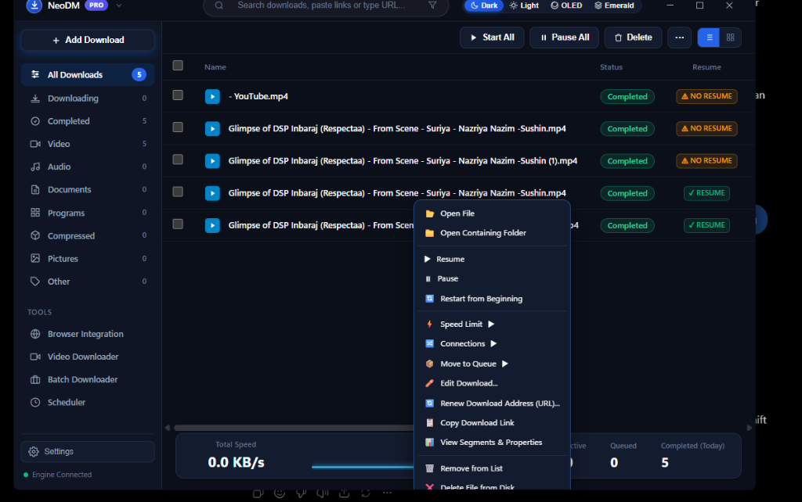

# 🧩 NeoDM Browser Companion Extension Guide

The **Neo Download Manager PRO (NeoDM)** Browser Companion Extension seamlessly connects your web browser to the high-speed NeoDM download engine. With Manifest V3 support, it enables 1-click downloads, intelligent file type interception, authenticated link forwarding (passing session cookies & headers), and instant media capture.



---

## 📑 Table of Contents
1. [Supported Browsers](#-supported-browsers)
2. [Automatic Setup via Installer](#-automatic-setup-via-installer)
3. [Manual Installation (Developer Mode)](#-manual-installation-developer-mode)
   - [Google Chrome](#1-google-chrome)
   - [Microsoft Edge](#2-microsoft-edge)
   - [Brave Browser](#3-brave-browser)
   - [Mozilla Firefox](#4-mozilla-firefox)
4. [How Interception Works](#-how-interception-works)
5. [Configuring Extension Options](#-configuring-extension-options)
6. [YouTube & Media Capture](#-youtube--media-capture)
7. [Troubleshooting & Connection Issues](#-troubleshooting--connection-issues)

---

## 🌐 Supported Browsers

| Browser | Engine | Extension Type | Native Messaging Support |
| :--- | :--- | :--- | :---: |
| **Google Chrome** | Chromium | Manifest V3 | ✅ Yes |
| **Microsoft Edge** | Chromium | Manifest V3 | ✅ Yes |
| **Brave** | Chromium | Manifest V3 | ✅ Yes |
| **Opera / Vivaldi** | Chromium | Manifest V3 | ✅ Yes |
| **Mozilla Firefox** | Gecko | Manifest V3 / V2 WebExtension | ✅ Yes |

---

## ⚡ Automatic Setup via Installer

When you install NeoDM using **`NeoDM-PRO-Setup.exe`**, the installer automatically registers the Windows Native Messaging Host registry keys:
- `HKCU\Software\Google\Chrome\NativeMessagingHosts\com.neodm.downloader`
- `HKCU\Software\Microsoft\Edge\NativeMessagingHosts\com.neodm.downloader`
- `HKCU\Software\Mozilla\NativeMessagingHosts\com.neodm.downloader`

After running the installer:
1. Open NeoDM.
2. Navigate to **Tools** → **Browser Integration**.
3. Follow the 1-click prompt to load the companion extension directory into your browser.

---

## 🛠️ Manual Installation (Developer Mode)

The companion extension source files are packaged inside your NeoDM directory at:
```text
C:\Users\<YourUsername>\AppData\Local\Programs\NeoDM\extension
```
*(Or inside the `extension/` folder of your portable NeoDM folder).*

You can quickly locate this folder from within NeoDM:
- Click **Tools** in the top navigation bar.
- Click **Browser Integration**.
- Click **"Open Folder in Explorer"** to reveal the folder with files highlighted.
- Or click **"Copy Path"** to put the exact folder path onto your Windows clipboard.

---

### 1. Google Chrome

1. Open **Google Chrome** and paste the following into the address bar:
   ```text
   chrome://extensions
   ```
2. In the top-right corner of the Extensions page, toggle **Developer mode** to **ON**.
3. In the top-left menu bar, click the **Load unpacked** button.
4. Browse to and select the `extension` folder (or paste the copied path into the File dialog's address bar).
5. The **NeoDM Download Companion** extension will appear in your extensions list.
6. Click the Extensions (puzzle piece) icon on the Chrome toolbar and pin **NeoDM** for easy 1-click access.

---

### 2. Microsoft Edge

1. Open **Microsoft Edge** and enter:
   ```text
   edge://extensions
   ```
2. In the left sidebar, enable the toggle labeled **Developer mode**.
3. Click the **Load unpacked** button at the top of the page.
4. Select the NeoDM `extension` directory and click **Select Folder**.
5. Edge will register the extension immediately.

---

### 3. Brave Browser

1. Open **Brave** and navigate to:
   ```text
   brave://extensions
   ```
2. Enable **Developer mode** via the toggle in the top-right corner.
3. Click **Load unpacked** and choose your NeoDM `extension` directory.
4. NeoDM will now intercept download links in Brave with full ad-blocking and privacy protections intact.

---

### 4. Mozilla Firefox

1. Open **Firefox** and type the following in the URL bar:
   ```text
   about:debugging#/runtime/this-firefox
   ```
2. Click **Load Temporary Add-on...**.
3. Navigate to the `extension` directory and select either `manifest.json`.
4. Firefox will load the companion add-on immediately.

---

## 🎯 How Interception Works

Once active, the NeoDM Companion Extension operates seamlessly in the background:

### 1. File Type Interception
Whenever you click a download link in your browser matching monitored extensions (e.g., `.iso`, `.zip`, `.exe`, `.tar.gz`, `.mp4`, `.pdf`, `.msi`, `.7z`), the extension interrupts the browser's default download manager.

### 2. Cookie & Authentication Forwarding
For downloads behind private portals, cloud storage (Google Drive, Dropbox, Mega), or internal corporate intranets:
- The extension extracts your active **session cookies** and HTTP `User-Agent`.
- It securely forwards these credentials via local RPC (`http://127.0.0.1:8998/api/download`) directly to the NeoDM core engine.
- NeoDM authenticates as your browser, preventing `403 Forbidden` or login-redirect errors.

### 3. Bypass Hotkey
If you want the browser itself to download a file instead of NeoDM:
- **Hold `Alt`** while clicking any download link.
- The companion extension will ignore the click and allow native browser downloading.

---

## ⚙️ Configuring Extension Options

Click the NeoDM extension icon in your browser toolbar to open the quick settings popup:
- **Enable / Disable Interception**: Pause automatic download grabbing without uninstalling the extension.
- **Monitored File Types**: Add or remove custom file extensions (e.g. adding `.flac`, `.apk`, `.dmg`).
- **Minimum File Size**: Set an interception threshold (e.g., only grab files larger than 1 MB, preventing small icons or HTML files from being caught).
- **Silent Mode**: Direct downloads straight to your default directory without displaying the "Add Download" modal.

---

## 🎥 YouTube & Media Capture

When browsing video platforms such as YouTube, Vimeo, or HTML5 media sites:
1. Click the **NeoDM Extension icon** on your toolbar.
2. Select **"Capture Media on Page"**.
3. The extension scans the page DOM and network requests for video and audio streams.
4. Click **Download with NeoDM** to send the stream URL directly into NeoDM's built-in **Silent Video Downloader**, where you can select 1080p, 720p, or Audio Extraction!

---

## 🔍 Troubleshooting & Connection Issues

### Extension says "Engine Disconnected" or "Cannot connect to NeoDM"
1. **Ensure NeoDM is Running**: The desktop application must be open (or minimized to the Windows system tray) to receive downloads.
2. **Verify Port Availability**: NeoDM's local HTTP API runs on port `8998`. If another application is using port 8998, check NeoDM's **Settings** → **Port Configuration**.
3. **Check Firewall Software**: Some third-party antivirus suites restrict loopback connections (`127.0.0.1`). Ensure loopback traffic to port `8998` is allowed.
4. **Re-Register Native Messaging**: In NeoDM, go to **Tools** → **Browser Integration** and click **Re-register Native Host**.

---

*For further assistance, visit the [NeoDM GitHub Repository](https://github.com/aloysiuspattath/neodm) or read the complete [User Guide](GUIDE.md).*
