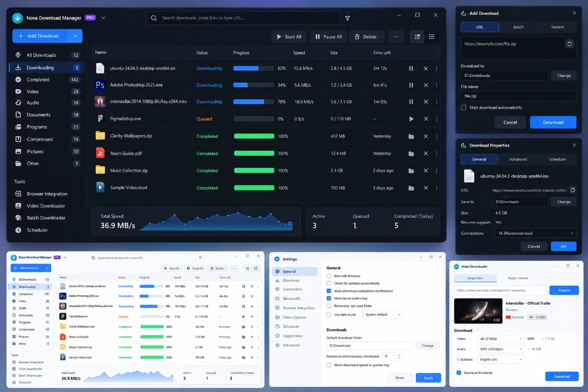
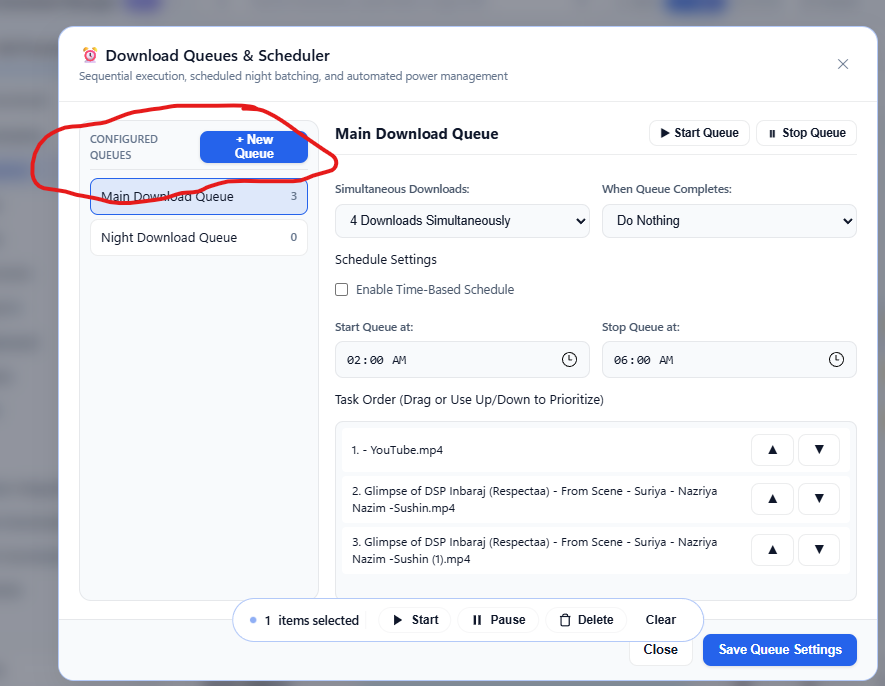
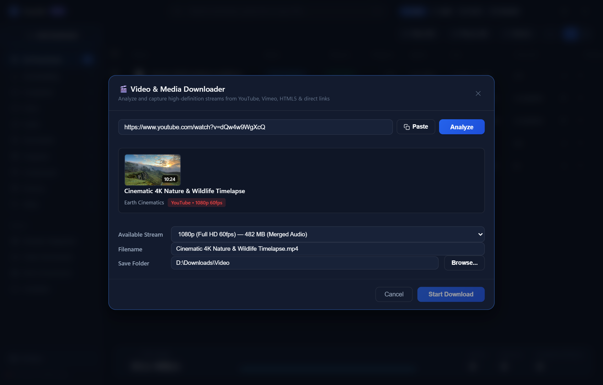
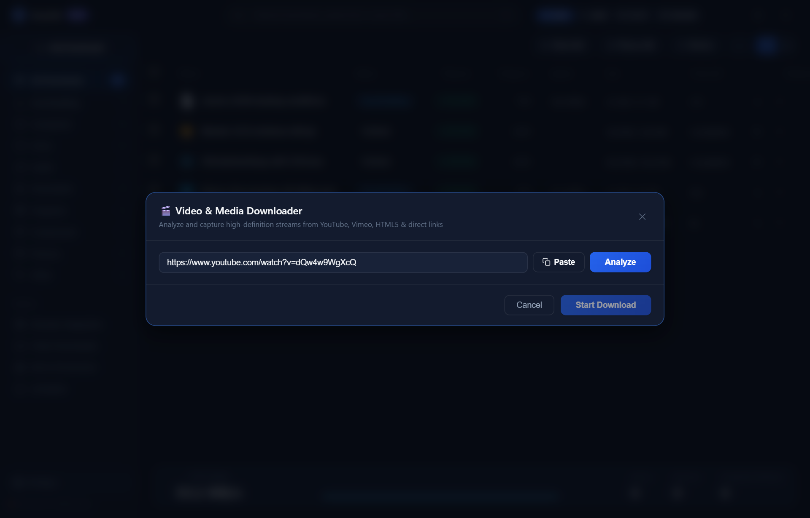
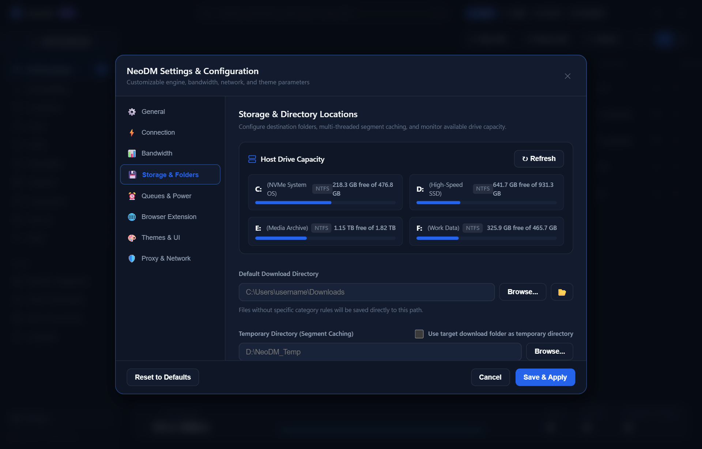
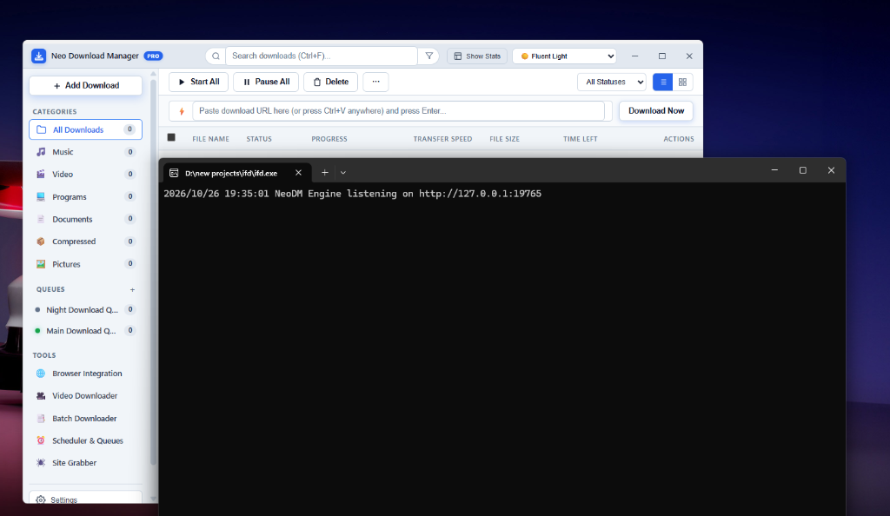

# 📖 Neo Download Manager PRO (NeoDM) User Guide

Welcome to the definitive user guide for **Neo Download Manager PRO (NeoDM)** — the next-generation, high-performance Windows download manager, multimedia sniffer, and download accelerator.

---

## 📑 Table of Contents
1. [Overview & Architecture](#-overview--architecture)
2. [Installation & Getting Started](#-installation--getting-started)
3. [The Bento Dashboard](#-the-bento-dashboard)
4. [Adding & Managing Downloads](#-adding--managing-downloads)
5. [File Conflict & Overwrite Actions](#-file-conflict--overwrite-actions)
6. [Dynamic Turbo Multi-Threading & Segments](#-dynamic-turbo-multi-threading--segments)
7. [Silent YouTube & Video Downloader](#-silent-youtube--video-downloader)
8. [Storage & Host Drive Capacity Monitoring](#-storage--host-drive-capacity-monitoring)
9. [Queue Management & Night Scheduler](#-queue-management--night-scheduler)
10. [Site Grabber & Batch Pattern Expander](#-site-grabber--batch-pattern-expander)
11. [Bandwidth Limiter](#-bandwidth-limiter)
12. [Windows System Tray & Power Options](#-windows-system-tray--power-options)
13. [Command-Line Interface (CLI) Manual](#-command-line-interface-cli-manual)
14. [Frequently Asked Questions (FAQ) & Troubleshooting](#-frequently-asked-questions-faq--troubleshooting)

---

## 🚀 Overview & Architecture

NeoDM is designed from the ground up in pure **Go** paired with a lightweight **Microsoft Edge WebView2** frontend, delivering maximum throughput and resource efficiency:

- **Direct Offset Writing (`WriteAt`)**: Pre-allocates target sparse files on disk. Incoming chunks stream straight to their precise byte offsets, eliminating the post-download concatenation delay (0s assembly freeze).
- **Dynamic Segment Subdivision**: Automatically identifies and divides the largest remaining byte ranges when worker threads finish early, ensuring all TCP connections stay saturated up to 100%.
- **Silent Background Execution**: Executes external tools (`yt-dlp` and `ffmpeg`) in fully hidden background worker mode (`HideWindow: true`) with no flashing Command Prompt windows.
- **Ultra-Low Memory Footprint**: Runs comfortably at `<35 MB RAM` and launches in `<200 ms`.

---

## 💾 Installation & Getting Started

### 1. Setup Wizard (`NeoDM-PRO-Setup.exe`)
- Runs a guided setup deploying NeoDM to `%LOCALAPPDATA%\Programs\NeoDM`.
- Installs the high-resolution desktop icon, Start Menu entry, and Windows Add/Remove Programs entry.
- Automatically registers Windows Native Messaging Host registry keys for Chrome, Edge, and Firefox.

### 2. Portable Mode (`NeoDM-PRO-windows-x64.zip`)
- Extract the archive to any folder or external USB drive.
- Run `neodm.exe` directly. All configurations and temporary data are contained within the folder.

### 3. Single-Instance Protection & Fast Launch
- NeoDM prevents duplicate background instances.
- If you launch `neodm.exe` while it is already running (e.g., minimized to the tray), the existing instance instantly activates, restores its window, and brings itself to the foreground without stealing focus from Windows Explorer.

---

## 🍱 The Bento Dashboard

The user interface follows a modern **Bento Grid** architecture designed for clarity, high information density, and effortless navigation:



### Key Dashboard Components:
1. **Top Quick Action Bar**:
   - **+ Add URL**: Quickly opens the URL input modal.
   - **Video Grabber**: Launches the dedicated multimedia extractor.
   - **Site Grabber**: Launches the batch website spider.
   - **Queue Controls**: Start, pause, or resume all queue items with one click.
   - **Settings & Theme**: Switch between **🌙 Bento Dark**, **☀️ Bento Light**, **🌌 Midnight Obsidian**, and **🌲 Forest Emerald**.
2. **Real-Time Telemetry Bar**: Displays active download count, aggregated download speed (MB/s), and real-time canvas sparkline graph.
3. **Category Sidebar**: Quick filtering across **All**, **Downloading**, **Finished**, **Compressed**, **Documents**, **Music**, **Programs**, and **Videos**.
4. **Download Cards & Table**: Detailed status for each download, including file name, size, percentage, current speed, ETA, connection count, and instant action buttons (Pause, Resume, Open, Delete).

---

## 📥 Adding & Managing Downloads

### Method 1: Top Quick-Add Bar
1. Paste any download URL directly into the URL bar or click **+ Add URL** (`Ctrl+N`).
2. NeoDM automatically parses the filename from HTTP headers (`Content-Disposition`) or URL structure.
3. Select your target directory (or let NeoDM auto-categorize based on file extension).
4. Choose the number of parallel connections (1 to 32).
5. Click **Start Download** or **Add to Queue**.

### Method 2: Automatic Clipboard Detection
If enabled in **Settings**, NeoDM automatically monitors your clipboard. Copying any link ending in monitored extensions (`.iso`, `.zip`, `.exe`, `.tar.gz`, etc.) triggers a non-intrusive flyout offering to start the download immediately.

### Method 3: Browser Extension
Clicking download links in Chrome, Edge, Brave, or Firefox automatically hands the file off to NeoDM. See the [Browser Extension Setup Guide](BROWSER_EXTENSION_GUIDE.md) for complete details.

---

## ⚠️ File Conflict & Overwrite Actions

When you start downloading a file that already exists in your destination folder, NeoDM prevents accidental data loss by presenting an intelligent **File Conflict Dialog**:

```text
┌────────────────────────────────────────────────────────────────┐
│ ⚠️ File Already Exists                                         │
│ File "ubuntu-24.04-desktop-amd64.iso" already exists in target  │
│ directory: D:\Downloads\ISO\                                   │
│                                                                │
│ [Overwrite]        [Rename: ubuntu-24.04-desktop-amd64 (1).iso]│
│ [Cancel]                                                       │
└────────────────────────────────────────────────────────────────┘
```

- **Overwrite**: Replaces the existing file on disk and starts fresh.
- **Rename**: Automatically appends an incremented suffix (e.g. `(1).iso`, `(2).iso`) preserving your original file.
- **Cancel**: Aborts the operation without touching your storage.

---

## ⚡ Dynamic Turbo Multi-Threading & Segments

NeoDM splits files into dynamic byte ranges across multiple simultaneous TCP connections to maximize bandwidth utilization:



### Real-Time Segment Monitor
- Right-click any active download and select **Download Properties** to view live segment diagnostics.
- Each connection stream displays its byte offset, chunk size, download rate, and visual progress bar.
- If a connection slows down or finishes early, NeoDM's **Dynamic Segment Subdivision** immediately re-splits remaining chunks so no bandwidth is left idle.

---

## 🎥 Silent YouTube & Video Downloader

NeoDM features a built-in media sniffer powered by `yt-dlp` and `ffmpeg` that runs completely in the background:



### How to Download Videos:
1. Click **Video Grabber** from the top bar or menu.
2. Enter the URL (YouTube, Vimeo, Twitch, Twitter/X, Facebook, etc.).
3. NeoDM analyzes the media and presents available video and audio streams:
   - **1080p (Full HD)**, **720p (HD)**, **480p**, **360p**
   - **Audio Only**: Extracted directly to pristine `.mp3` or `.m4a` format.
4. Select your preferred stream and click **Download Video**.
5. NeoDM streams both video and audio tracks simultaneously, merges them into a clean `.mp4` container via `ffmpeg`, and saves it directly to your `Videos` folder — all with **zero flashing terminal windows**!



---

## 💽 Storage & Host Drive Capacity Monitoring

NeoDM integrates directly with the Windows Win32 Disk Management API to provide real-time visibility into all connected storage volumes:



- **Drive Enrolment**: Automatically scans and displays all mounted logical drives (`C:`, `D:`, `E:`, `F:`, `G:`, `H:`, `I:`).
- **Live Capacity Metrics**: Displays the drive volume label, file system (NTFS/exFAT), free space in GB, total space in GB, and a color-coded percentage utilization bar.
- **Automatic Folder Categorization**: Downloads are systematically sorted by file extension:
  - `Compressed`: `.zip`, `.rar`, `.7z`, `.tar`, `.gz`, `.bz2`
  - `Documents`: `.pdf`, `.docx`, `.xlsx`, `.pptx`, `.txt`
  - `Music`: `.mp3`, `.flac`, `.wav`, `.aac`, `.m4a`
  - `Programs`: `.exe`, `.msi`, `.bat`, `.cmd`
  - `Video`: `.mp4`, `.mkv`, `.avi`, `.mov`, `.webm`
- **Configurable Scratch Directory**: Direct temporary chunks to high-capacity secondary drives to protect system SSDs with low disk space.

---

## 📋 Queue Management & Night Scheduler



Organize large download sets and optimize off-peak bandwidth:
- **Main Queue**: Standard sequential or concurrent download queue.
- **Night Queue**: Schedules batch downloads to start automatically during off-peak hours (e.g. 01:00 AM – 06:00 AM).
- **Post-Download Power Actions**:
  - Shut down computer on completion
  - Put computer to sleep
  - Disconnect network connection
  - Close NeoDM

---

## 🕸️ Site Grabber & Batch Pattern Expander

### 1. Site Grabber
- Crawls entire websites or directory listings up to a user-defined recursion depth.
- Filters by file extension (`.pdf`, `.jpg`, `.mp4`) or regular expressions.
- Lets you select and download discovered assets in bulk.

### 2. Batch Pattern Expander
Download sequential assets in one command:
```text
https://assets.example.com/archive_[01-50].zip
https://cdn.example.com/books/chapter_[001-120].pdf
```
Expands into hundreds of queued download tasks instantly with no manual copying.

---

## 🚦 Bandwidth Limiter

Never let downloads saturate your entire internet connection while gaming, streaming, or video conferencing:
- **Global Limiter**: Set a system-wide download ceiling (e.g., `5.0 MB/s`).
- **Per-Download Limiter**: Throttle individual downloads while letting critical downloads run at full speed.
- Powered by a mathematically precise token-bucket algorithm for steady, jitter-free throughput.

---

## 🔔 Windows System Tray & Power Options

NeoDM docks neatly into the Windows Notification Area (System Tray):
- **Left-Click**: Restores or minimizes the NeoDM window.
- **Right-Click Native Menu**:
  - **Show NeoDM PRO**: Brings the application to the foreground.
  - **Pause All Downloads**: Pauses all active connections immediately.
  - **Resume All Downloads**: Restarts paused downloads from their exact byte positions.
  - **Open Downloads Folder**: Reveals your main download directory in Windows Explorer.
  - **Settings**: Opens the configuration modal.
  - **Exit**: Safely flushes data, closes network sockets, and terminates the application.
- **Silent Close to Tray**: Closing the window with the `X` button minimizes NeoDM to the tray without interrupting active transfers (configurable in Settings).

---

## 💻 Command-Line Interface (CLI) Manual

The exact same `neodm.exe` binary functions as an industrial-grade terminal download manager:

### Basic Download
```powershell
neodm https://speed.cloudflare.com/__down?bytes=104857600 -o 100mb.bin
```

### Advanced Multi-Threaded Download
```powershell
neodm download https://example.com/ubuntu-24.04.iso -d D:\ISOs -c 32 -s 10M
```
- `-d, --dir`: Specify destination folder.
- `-c, --conns`: Number of parallel connections (1 to 32).
- `-s, --speed`: Bandwidth limit (e.g. `5M`, `500K`).
- `-o, --out`: Output filename.

### List Active Tasks
```powershell
neodm list
```

### Version Information
```powershell
neodm version
```

---

## ❓ Frequently Asked Questions (FAQ) & Troubleshooting

### Q: Why do downloads start so much faster than other download managers?
NeoDM writes directly to target file offsets (`WriteAt`) using pre-allocated sparse files. When a download hits 100%, it is **already assembled on disk**, eliminating minutes of disk-concatenation freeze seen in legacy tools.

### Q: What if an error occurs while fetching video info?
Make sure your system has an active internet connection. If downloading age-restricted or private videos, ensure you have exported your browser cookies using the NeoDM Companion Extension.

### Q: Does NeoDM work on Windows 10 and Windows 11?
Yes! NeoDM is fully optimized for Windows 10 and Windows 11 with PerMonitorV2 High-DPI scaling, DWM Dark Aero Snap, and native Win32 system tray support.

### Q: How do I update NeoDM?
Simply run `NeoDM-PRO-Setup.exe` at any time. The installer automatically detects your existing installation and prompts you with **Update / Reinstall**, **Uninstall**, or **Exit**. Updating preserves all your downloads, history, categories, and settings while seamlessly upgrading the binary and components.

### Q: How do I restart NeoDM if needed?
Right-click the NeoDM icon in the Windows system tray and click **"Restart NeoDM"**, or open the in-app Settings dialog and click **"🔄 Restart NeoDM"**. This cleanly restarts the background server, engine, and interface without needing task manager or manual command prompt kills.

---

*For bug reports, feature requests, or contributions, visit the [NeoDM GitHub Repository](https://github.com/aloysiuspattath/neodm).*
